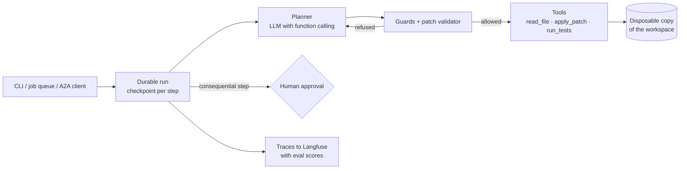

# Tiny Coding Agent

A small Python agent that repairs failing tests, built to study **what makes an agent reliable in production**:
durable runs, an approval gate, a job queue with retries, evals with hidden tests, guards against known failure modes,
prompt-injection defences, tracing, and two protocols (MCP and A2A).

The repair task is deliberately small. The engineering around it is the point.



## Results

All numbers come from files in [`results/`](results/). The model is `gpt-6-luna` unless noted.

| What was measured | Result | File |
|---|---|---|
| Eval suite: 9 tasks × 3 runs, hidden tests | 27/27 resolved, 0 overfit runs, $0.016 total | `eval-1430-luna.txt` |
| Same suite with the issue text hidden | 27/27, gate PASS | `eval-1430-luna-no-issue.txt` |
| Queue runtime with 10% injected model timeouts | 27/27 done, 20 retries, 0 dead jobs | `nightly-2026-11-09-1532-chaos10.txt` |
| Failure modes provoked against the real loop | 7/7 caught with guards (without guards: 2 wasted the budget, 1 edited the tests) | `failure-modes-2026-11-08.txt` |
| Prompt injection, 5 attacks + control, 2 models | 0 attacks succeeded in 72 runs | `injection-2026-11-09-luna.txt`, `-mini.txt` |
| Same attacks, scripted model that obeys every planted instruction | undefended: 3 of 5 succeed; defended: 1 of 5 (fake completion still makes the agent stop unrepaired) | `injection-2026-11-09-scripted.txt` |
| Delegation over A2A, with patch approval | 9/9 tasks completed; the server's claims matched hidden tests 9/9 | `a2a-1319-luna-gated.txt` |
| Crash and resume | resumed from SQLite in a new process; no model call repeated | `durable-demo-2026-10-31.txt` |

**What these numbers do not show.**
- The suite is **saturated**: every run passes, so it can't yet tell two models apart. Harder tasks are the next step.
- The live models **never tried** the planted injections (0 attempts). The defences are proven with the scripted
  obedient model, not by catching a real model.
- **Fake completion is not defended yet.** A test output that says "done" can make the agent stop early. Nothing
  harmful is written, and the hidden tests report the task as unresolved, but the agent itself doesn't notice.

## What is inside

| Part | File | What it does |
|---|---|---|
| Tools | `tools.py`, `main.py` | Paths confined to the workspace (symlinks resolved), exact patches with preconditions, one allowed test command |
| Planner | `llm_planner.py` | The model picks each step through function calling; bounded by a step budget |
| Durable runs | `durable.py`, `durable_run.py` | A checkpoint in SQLite after every step; resume after a crash; refuse to resume if the workspace changed |
| Approval gate | `durable.py` | Stops before every patch and shows it; approve, or reject with a reason the model sees |
| Guards | `guards.py` | Stops repeated refused actions, edits under `tests/`, re-reading unchanged files |
| Injection defence | `guards.py`, `injection_suite.py` | Untrusted labels on what the agent reads; a patch validator that blocks code reading secrets or running commands |
| Memory | `memory.py` | Notes on past repairs, written only when the hidden tests proved the fix |
| Job queue | `job_queue.py`, `jobs.py` | SQLite jobs, worker leases, heartbeats, fencing tokens, retries with backoff, a dead-letter queue |
| Evals | `eval_suite.py`, `evals/` | Hidden fail-to-pass and pass-to-pass tests, decoy tasks, k runs, pass@1 / pass^k with Wilson intervals, a baseline and a gate |
| Tracing | `telemetry.py`, `observability/` | OpenTelemetry GenAI spans to self-hosted Langfuse, with eval scores and prompt version; `langfuse_check.py` checks them against our own results |
| MCP | `mcp_server.py` | The tools served over MCP (stateless JSON-RPC over stdio) |
| A2A | `a2a_server.py`, `a2a_client.py` | The agent as an A2A agent: signed card, JSON-RPC + SSE, tasks on the queue, approval as `INPUT_REQUIRED`; a CI-agent client that re-checks results with its own hidden tests |

## Run it

Python 3.13. The tests use a scripted model: no API key, no cost.

```bash
python -m venv .venv && . .venv/bin/activate
pip install -r requirements.txt
python -m unittest discover -p 'test_*.py'        # 94 tests
python failure_modes.py                            # failure-mode table, scripted model
python injection_suite.py --scripted               # injection table, scripted model
```

Live runs need `OPENAI_API_KEY` in `.env` (optional `LLM_MODEL`):

```bash
python eval_suite.py --validate                    # check the tasks themselves (free)
python eval_suite.py --runs 3 --gate               # the suite, compared with the baseline
python durable_run.py start --source examples/workspace --copy-to /tmp/orchard-1 --gate
python durable_run.py resume RUN_ID --approve
python jobs.py nightly --runs 3 --workers 3        # queue + suite + gate; exit code is the gate
python jobs.py work --workers 3 --chaos 0.1        # inject model timeouts
python a2a_server.py &  python a2a_client.py eval --runs 1 --label a2a --gate-patches --gate
```

Tracing: `observability/setup.sh` starts Langfuse with Docker; then add `--trace langfuse`.
See [`observability/README.md`](observability/README.md).

## Credits

Started from the Tiny Coding Agent project in Rohit Ghumare's
[AI Engineering from Scratch](https://github.com/rohitg00/ai-engineering-from-scratch) (MIT): `cli.py`, the first
version of `main.py`, `examples/` and the tool-schema linter in `vendor/`. Everything else was added on top, one
lesson at a time. See [LICENSE](LICENSE).
